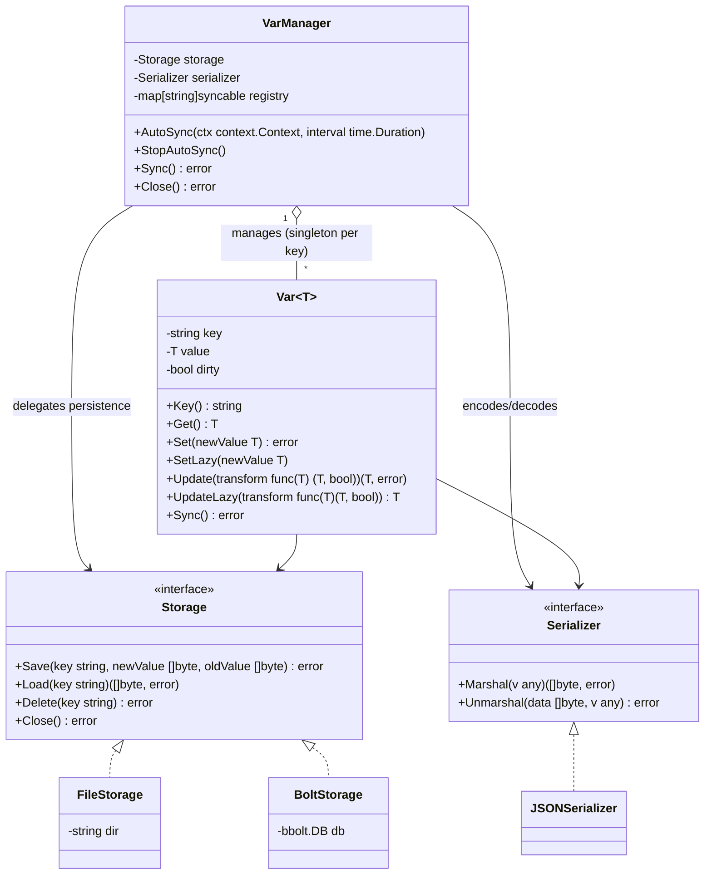

# PersistVar

Go library for **typed persistent variables** with generics support (`Var[T]`), atomic operations, and pluggable storage backends.

[](https://pkg.go.dev/github.com/eos175/persistvar)
[](LICENSE)

---

## 📂 Project Structure

```
persistvar/
│
├── storage/
│   ├── filestorage.go       # File-based persistence (one file per variable)
│   ├── boltstorage.go       # BoltDB-based persistence (embedded B+Tree KV)
│   └── storage_test.go      # Storage backend tests and concurrency stress tests
│
├── var.go                   # Generic Var[T] with atomic and lazy mutations
├── manager.go               # VarManager with singleton registry and AutoSync
├── storage.go               # Storage and Serializer interfaces + JSONSerializer
├── var_test.go              # Unit tests for singleton, atomic updates, and keys
├── go.mod
├── LICENSE
└── README.md
```

---

## 📜 Usage Example

```go
package main

import (
	"context"
	"fmt"
	"time"

	"github.com/eos175/persistvar"
	"github.com/eos175/persistvar/storage"
)

func main() {
	// 1. Initialize storage backend (FileStorage or BoltStorage)
	store, _ := storage.NewFileStorage("persistent_data")
	// store, _ := storage.NewBoltStorage("vars.db")

	// 2. Create VarManager (uses JSONSerializer by default if nil)
	mgr := persistvar.NewVarManager(store, nil)
	defer mgr.Close() // Automatically flushes pending lazy changes and closes storage

	// 3. Optional: Background automatic synchronization
	ctx, cancel := context.WithCancel(context.Background())
	defer cancel()
	mgr.AutoSync(ctx, 5*time.Second)

	// 4. Declare persistent variables with lazy default factory functions
	counter, _ := persistvar.NewVar(mgr, "counter", func() int { return 0 })
	username, _ := persistvar.NewVar(mgr, "username", func() string { return "anon" })

	// 5. Update values: Immediate or Lazy
	username.Set("Emmanuel") // Persisted immediately to disk

	counter.UpdateLazy(func(curr int) (int, bool) {
		return curr + 1, true // In-memory update, flushed during AutoSync or Close()
	})

	fmt.Println("Counter:", counter.Get())
	fmt.Println("Username:", username.Get())
}
```

---

## 📊 Visual API Architecture



---

## 🔄 Operations Flow: Immediate vs Lazy

```mermaid
flowchart TD
    subgraph Operations["Variable Mutation"]
        A["Set(val) / Update(fn)"]
        B["SetLazy(val) / UpdateLazy(fn)"]
    end

    subgraph Memory["Thread-Safe In-Memory State"]
        M1["Lock RWMutex"]
        M2["Update value"]
        M3["Mark dirty = true"]
        M4["Unlock RWMutex"]
    end

    subgraph Persistence["Storage Write"]
        S1["Serializer.Marshal(value)"]
        S2["Storage.Save(key, newBytes, oldBytes)"]
        S3["Mark dirty = false"]
    end

    A --> M1 --> M2 --> S1 --> S2 --> S3 --> M4
    B --> M1 --> M2 --> M3 --> M4

    Trigger["AutoSync ticker / mgr.Sync() / mgr.Close()"] -.-> S1
```



---

## 🛠️ API Reference & Explanations

### Singleton Registry & Lazy Initialization

`NewVar` manages variables through an internal registry in `VarManager`:
- **Singleton by Key**: Calling `NewVar` multiple times with the same key returns the exact same `*Var[T]` pointer instance.
- **Lazy Default Factory**: The third parameter is a function `func() T`. This factory is **only evaluated if the key does not exist on disk**, preventing unnecessary memory allocations or costly setup computations when restoring existing variables.
- **Type Safety Check**: If an existing key was registered under a different type, `NewVar` returns an error instead of corrupting state.

### Atomic Updates

- `Update(transform func(curr T) (new T, changed bool)) (T, error)`
  - Executes `transform` inside the variable's write lock.
  - If `changed == false`, no mutation or write occurs.
  - If `changed == true`, updates in memory and persists immediately to storage.
- `UpdateLazy(transform func(curr T) (new T, changed bool)) T`
  - Same atomic execution under lock as `Update`.
  - If `changed == true`, updates value in memory and marks it dirty. It will be flushed on the next `AutoSync`, `Sync()`, or `Close()`.

### Variable Key Format

- Keys must match the regex `^[a-zA-Z0-9._-]+$`.
- Invalid characters return an error during `NewVar`.

### Storage Interface & Write Optimization

`Storage` defines how bytes are saved and retrieved:

```go
type Storage interface {
    Save(key string, newValue []byte, oldValue []byte) error
    Load(key string) ([]byte, error)
    Delete(key string) error
    Close() error
}
```

- **Write Optimization**: `Save` receives both `newValue` and `oldValue`. If `bytes.Equal(newValue, oldValue)`, the storage implementation skips writing to disk.

---

## 📦 Serialization

- **Default**: `JSONSerializer` is used automatically if `nil` is passed to `NewVarManager`.
- **Custom Formats**: Implement the `Serializer` interface to use Protobuf, MsgPack, FlatBuffers, etc.:

```go
type Serializer interface {
    Marshal(v any) ([]byte, error)
    Unmarshal(data []byte, v any) error
}
```

Pass your custom serializer when instantiating the manager:
```go
mgr := persistvar.NewVarManager(store, myCustomSerializer)
```

---

## ⚡ Usage Recommendations

1. **FileStorage**: Use for lightweight scenarios or a small number of variables where having human-readable individual `.var` files is convenient.
2. **BoltStorage**: Use for high-concurrency, high write frequency, or projects managing many variables in a single database file.
3. **Graceful Shutdown**: Always combine `AutoSync` with `defer mgr.Close()`. `Close()` halts `AutoSync`, flushes any remaining dirty changes to disk, and closes the underlying storage cleanly:

```go
ctx, cancel := context.WithCancel(context.Background())
defer cancel()
mgr.AutoSync(ctx, 5*time.Second)
defer mgr.Close() // runs before cancel() due to LIFO defer order
```
